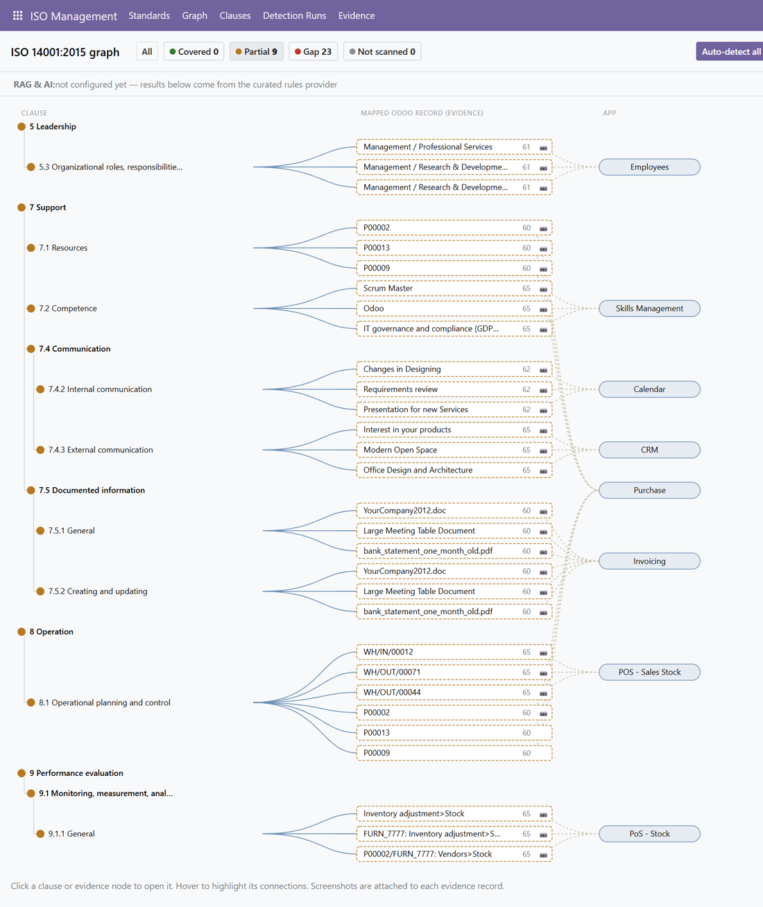
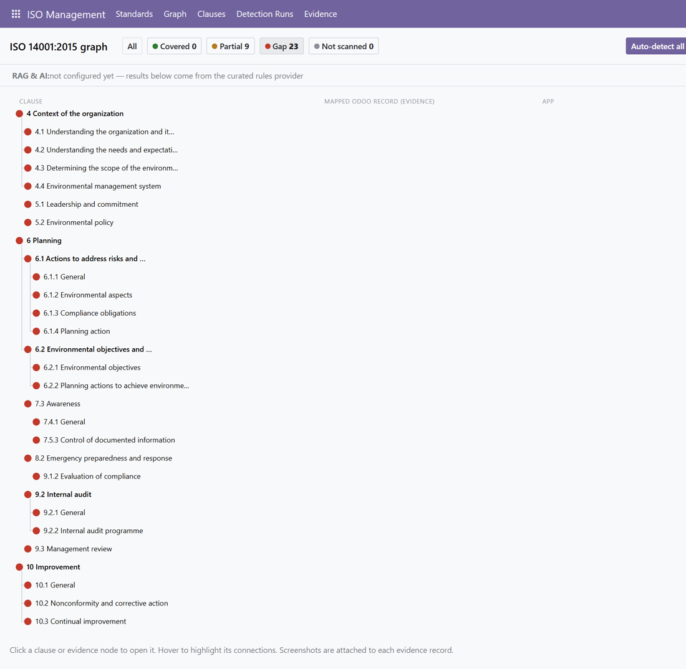
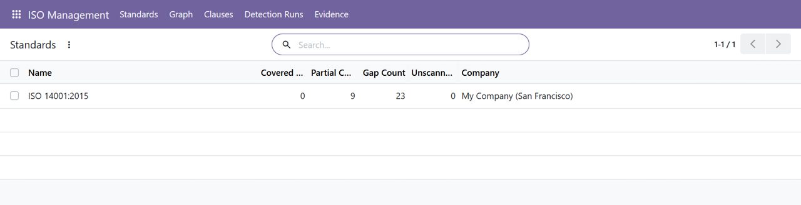
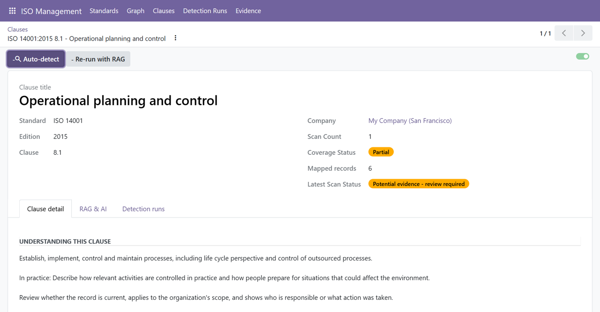
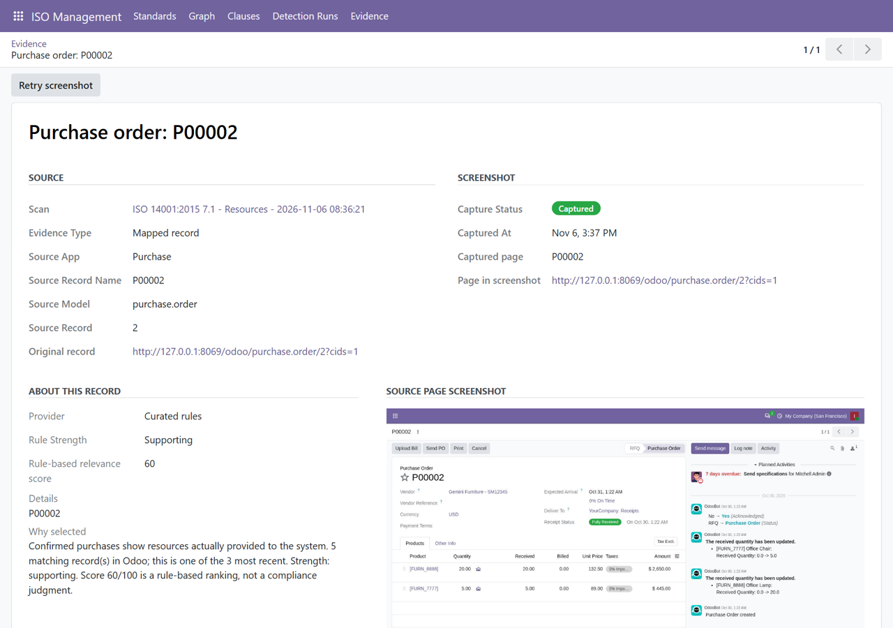

# ISO Management untuk Odoo 20

Modul Odoo 20 untuk memetakan klausul dummy **ISO** ke dokumen dan kegiatan nyata di Odoo,
lengkap dengan screenshot sebagai bukti dan graph relasi.

## Fitur
- **Katalog klausul** ISO (klausul 4-10, 45 klausul). Ringkasan berupa parafrase;
  teks resmi ISO tidak disertakan.
- **Auto-detect**: setiap klausul dihubungkan ke record Odoo lewat aturan terkurasi
  (`iso_management/models/iso_rules.py`), misalnya 8.1 ke pembelian dan transfer stok, 6.1.2 ke
  scrap move. Klausul tanpa aturan atau tanpa data tampil sebagai **Gap**, bukan dicocokkan dari kata umum.
- **Evidence**: alasan, nilai kecocokan, tautan ke record asli, dan screenshot halaman Odoo-nya.
- **Graph interaktif**: klausul -> evidence -> aplikasi dengan status Covered / Partial / Gap / Not scanned.
- **RAG + AI (opsional)**: embedding ke pgvector lalu dinilai LLM. Mati secara default.
  Setiap evidence diberi label provider yang menghasilkannya.

## Tampilan

**Graph** — klausul (kiri), evidence (tengah), dan aplikasi sumbernya (kanan). Titik hijau berarti tercakup,
kuning sebagian, merah celah. Klik node untuk membuka klausul atau evidence, arahkan kursor untuk menyorot
koneksinya. Contoh di bawah memakai filter *Partial*:



Filter *Gap* menampilkan klausul yang belum punya bukti, jadi celahnya langsung terlihat:



**Standards** — ringkasan cakupan per standar:



**Klausul** — tombol *Auto-detect*, status cakupan, dan jumlah record yang terpetakan:



**Evidence** — alasan terpilih, nilai kecocokan, provider (aturan atau RAG + AI), tautan ke record asli,
dan screenshot halaman sumbernya:



> Screenshot diambil dari data demo Odoo.

## Instalasi
1. Salin folder `iso_management/` ke addons path Odoo, lalu install dari Apps (atau `-i iso_management`).
2. Butuh PostgreSQL dengan ekstensi `pgvector` hanya jika memakai RAG (mis. image `pgvector/pgvector:pg17`)
   dan paket Python `requests`.
3. Buka **ISO Management > Standards**, lalu **Auto-detect all clauses** atau **Graph**.

## Worker screenshot (opsional)
Screenshot dibuat oleh worker Playwright di `iso_capture/`.
1. Tambahkan service dari `docker-compose.iso-capture.example.yaml`.
2. Buat akun worker: `python scripts/setup_iso_capture.py` (menulis login dan password acak ke `.env`;
   jaga kerahasiaannya).
3. `docker compose up -d --build iso-capture`.

Worker hanya mendapat akses baca sementara ke satu record setelah akses pemindai asli diperiksa.
Screenshot dapat memuat data bisnis, jadi ikuti hak akses ISO yang ada.

## Mengaktifkan RAG + AI
Isi variabel di `.env.example` (salin ke `.env`): `ISO_RAG_ENABLED=1`, `ANTHROPIC_API_KEY`, serta
`VOYAGE_API_KEY` atau `OPENAI_API_KEY`. Di form Standard pilih **Index records for RAG**, lalu
**Re-run with RAG**. Mengaktifkan ini berarti judul dan kutipan pendek record dikirim ke API eksternal.
Bagian RAG belum diuji end-to-end dengan API key sungguhan.

## Tes
```
odoo -d <db> -u iso_management --test-tags /iso_management --stop-after-init
```

## Catatan
- Aturan mapping dan judul klausul ditulis dari pengetahuan standar; cocokkan dengan salinan resmi
  ISO milikmu sebelum dipakai untuk audit.
- Hasil deteksi adalah kandidat untuk ditinjau manusia, bukan keputusan kesesuaian ISO.
